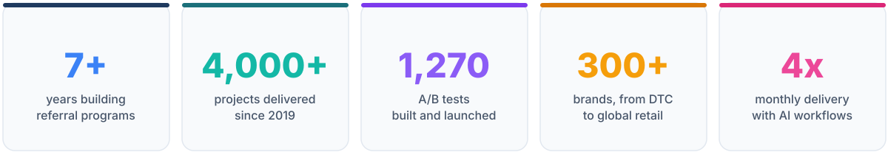

  <picture>
    <source media="(prefers-color-scheme: dark)" srcset="assets/banner-dark.svg">
    
  </picture>

  <picture>
    <source media="(prefers-color-scheme: dark)" srcset="https://readme-typing-svg.demolab.com?font=VT323&weight=400&size=26&duration=3000&pause=900&color=A8D43A&center=true&vCenter=true&width=640&lines=I+build+referral+programs+that+turn+customers+into+growth;1%2C270+A%2FB+tests+and+counting;Apple+%26+Google+Wallet+passes%2C+shipped;AI+agents+in+my+daily+workflow">
    
  </picture>

## 👋 About me

I'm a front-end and marketing-technology engineer in **Kyiv, Ukraine**. For 7+ years at [Talkable](https://www.talkable.com), I've built, tested and optimized referral programs for 300+ brands, including **American Eagle Outfitters, Puma, Coach, J.Crew, TOMS, Bombas, Hydrow and Rothy's**.

- 🧪 **Experimentation:** about 1,270 A/B tests, often one shared test across a dozen live campaigns
- 🎫 **Wallet:** the team's go-to Apple & Google Wallet specialist
- 📈 Worked on programs featured in Talkable case studies: **American Eagle Outfitters** (58x peak ROI), **SwimOutlet** (+278% referral revenue), **Puffy** (20x ROI)
- 🤖 **AI-assisted delivery:** wrote the Wallet skill for Talkable's AI Assistant; 4x monthly delivery after adopting AI workflows

  <picture>
    <source media="(prefers-color-scheme: dark)" srcset="assets/impact-dark.svg">
    
  </picture>

## 🛠️ Tech stack

  
  
  
  
  
  

  
  
  
  
  
  
  
  

## 🎮 Side projects & open source

- **[Sablune](https://helavika.github.io/sablune/)**: a tiny ASMR sand-art browser game. Slice soft sand, fill a glass jar, breathe. One `index.html` with canvas and Web Audio, every sound synthesized live ([source](https://github.com/helavika/sablune))
- **[Hatchstone](https://helavika.github.io/hatchstone/)**: a tiny ASMR game. Crack open real geodes, hatch glowlings and raise them in a cozy cave nest. 24 levels, 17 minerals, 26 creatures, no libraries and no asset files ([source](https://github.com/helavika/hatchstone))
- **[kaplay #1192](https://github.com/kaplayjs/kaplay/pull/1192)**: play sprite animations backwards in the KAPLAY game library
- **[passkit-generator #277](https://github.com/alexandercerutti/passkit-generator/pull/277)**: fix `appLaunchURL` rejecting valid URIs in the Node.js Apple Wallet pass library

## 📊 GitHub activity

Most of my work happens in private client repositories, so it shows up here as private contributions.

  <picture>
    <source media="(prefers-color-scheme: dark)" srcset="https://streak-stats.demolab.com?user=helavika&hide_border=false&card_width=600&background=0B0C08&border=5D7A1E&stroke=5D7A1E&ring=A8D43A&fire=E8803A&currStreakNum=A8D43A&sideNums=E9DCBC&currStreakLabel=A8D43A&sideLabels=B3A684&dates=B3A684">
    
  </picture>

